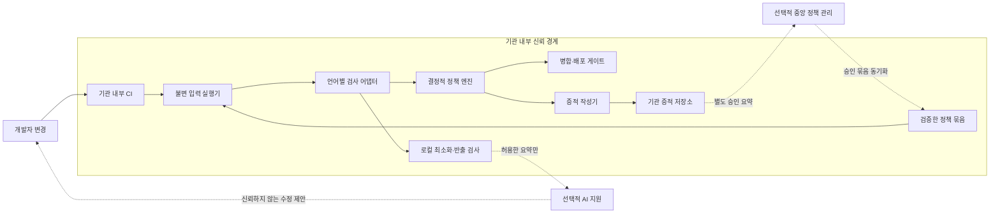
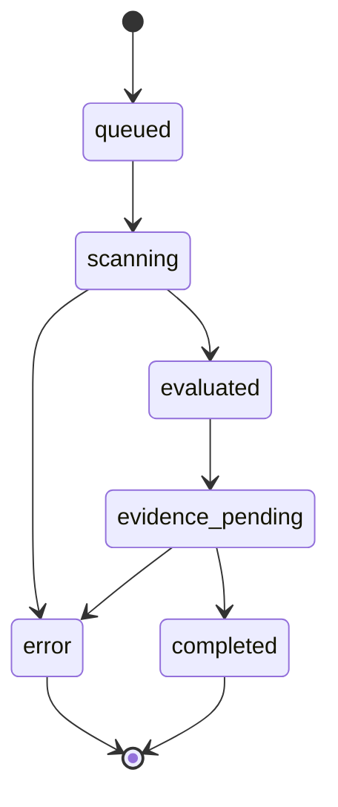

# 하이브리드 아키텍처 명세

상태: 공통 아키텍처와 첫 사례 참조 구현 / 기준일: 2026-10-29
제품 범위: 공공 프로젝트의 적용 규정 충족 안내. 첫 실행 사례: 민원 API 개인정보 로깅.

프로젝트 프로필 → 적용 규정·요구 → 수행 작업·산출물 → 자동 검사·수정 지원 또는 담당자 검토 → 승인·증적을 전체 제품 흐름으로 둔다.
아래 실행 계층은 첫 사례의 코드 검사·CI 흐름이다. 문서·설계·검수·운영 등 다른 분야의 입력과 검사는 후속 어댑터 설계 범위다.
[제품 방향](PRODUCT_DIRECTION.md)과 [ADR-0012](adr/0012-project-compliance-purpose.md)를 따른다. v0.9.0의 실제 구현·검증은 [완료 보고](RALPH_COMPLETION_REPORT.md)를 따른다.

## 1. 하이브리드의 두 축

배치 축은 **기관 내부 실행 영역 + 선택적 중앙 관리 영역**이다.
판정 축은 **결정적 검사·정책 집행 + 선택적 AI 설명·수정 제안**이다.
하이브리드가 원본 소스나 개인정보의 클라우드 전송을 뜻하지 않도록 경계를 명시한다.
중앙 관리 영역도 기관 내부에 설치할 수 있다. 기관별 망 구성과 반출 규정은 별도 적용성 검토 대상이다.

## 2. 구성요소와 책임

| 구성요소 | 입력 | 출력 | 실패 처리 |
| --- | --- | --- | --- |
| Control Plane | 정책 초안, 적용성, 승인 | 버전 고정 정책 묶음 | 기존 승인본 사용; 임의 최신본 금지 |
| Runner | commit/tree, 묶음 digest, 실행 설정 | Run, Finding, Decision, Evidence | 입력·도구 오류는 gate 실패 |
| Detector | 읽기 전용 소스, 지원 언어 목록 | 위치·분류·신뢰도·분석 범위 | 미지원·불완전 분석을 명시 |
| Policy Engine(PDP) | Finding, 버전 고정 통제, 승인 예외 | allow/deny/review_required/error | 데이터 누락·알 수 없는 정책은 error |
| Gate(PEP) | Decision, 현재 head, 증적 receipt | CI 상태 또는 병합 거부 | 서명·digest·head 불일치 거부 |
| Evidence Writer | 실행 메타데이터, 판정, 검사 결과 | manifest, 보관 receipt | 보관 실패 시 최종 allow 발행 금지 |
| Model Gateway | 로컬 최소화 후 허용한 자료 | 설명·수정 diff 제안 | 시간 초과 시 AI 없이 수동 수정 |

법적 근거 카탈로그는 사람이 검토한다. LLM이 추론한 규정을 자동으로 활성화하지 않는다.
기관 내부 원본 증적과 중앙 반출 요약은 서로 다른 데이터 객체다.

## 3. 검사 계약과 판정 의미

공통 JSON 계약은 `packages/contracts/catalog.schema.json`을 사용한다.
Detector의 결과는 `finding`, Policy Engine의 결과는 `decision`이다.
examples/complaints-api의 JSON은 정적 계약 자료다. 실제 로컬 실행 결과는 지정한 새 증적 디렉터리에 생성한다.

판정 우선순위는 입력 검증 실패/error → 미확정 적용성/review_required → 유효한 차단 finding/deny → allow다.
유효한 예외는 지정한 정책·finding 범위만 면제하며 다른 오류나 차단 finding을 해제하지 못한다.
활성 정책이 없거나 필수 detector가 실행되지 않았으면 allow가 아니다.
`allow`는 해당 스냅샷에서 필수 검사가 통과했다는 뜻이다. 규정 전체 준수를 뜻하지 않는다.
`review_required`와 `error`는 merge gate의 실패 상태로 매핑한다.

향후 CLI 종료 코드: 0=allow 및 증적 보관 완료, 2=deny, 3=review_required, 4=error.
소스 문장·민원 원문을 종료 메시지에 출력하지 않는다. 오류 로그에는 분류 코드와 불투명 실행 ID만 남긴다.

## 4. 실행 흐름과 상태

Run의 `status`와 Decision의 `outcome`은 다른 축이다. `completed + deny`도 정상 완료한 차단 검사다.
모든 판정은 보관을 시도하되, allow는 receipt까지 검증한 뒤 gate에 보고한다.
수정은 원래 Run을 덮어쓰지 않는다. `parent_run_id`를 가진 새 Run을 만든다.
실행 중 head가 바뀌면 게이트가 stale 결과를 거부하고 새 실행을 요청한다.
동일한 commit이라도 정책·도구 버전이 바뀌면 별도 Run으로 기록한다.

## 5. 내부 연결과 중앙 동기화

MVP 로컬 연결은 CLI와 파일 계약으로 시작한다. 서비스 분리는 필요할 때 추가한다.
Control Plane API 제안: 정책 초안 등록, 승인, 묶음 발행, 실행 요약 조회. 모든 요청에 기관·프로젝트 권한을 확인한다.
중앙 서버가 Runner에 임의 shell을 요청하는 인터페이스는 두지 않는다.
기관 측에서 묶음을 가져오거나 승인된 오프라인 전달 절차를 사용한다.
서명 검증 키의 신뢰 기준은 기관에서 설치하며, 서명 오류·만료·버전 역행은 거부한다.
캐시 정책도 `expires_at`과 기관·프로젝트 범위를 검사한다.
정책 긴급 철회는 오프라인 즉시 전파할 수 없다. 이 한계를 인정하고 캐시 유효기간과 운영 절차를 정한다.

## 6. 위협과 대응

| 위협 | 대응 | 남는 한계 |
| --- | --- | --- |
| 민원 본문이 로그·증적·프롬프트에 복제 | 허용 필드 기반 구조화 로그, 원문 제외, 로컬 반출 검사 | 경로·식별자 자체의 개인정보 여부도 검토 필요 |
| 코드·규정 문서에 포함된 프롬프트 주입 | 코드와 문서를 비신뢰 입력으로 처리, 도구 권한과 판정 분리 | AI 수정안은 항상 재검사 |
| 악성 저장소의 빌드 스크립트 실행 | 분석은 읽기 전용·외부 통신 차단, 테스트는 격리 환경 | 격리 런타임 자체의 보안 운영 필요 |
| 오래된 통과 결과 재사용 | 현재 head, tree, 묶음·도구 digest와 결과 연결 | CI 관리자 우회 권한은 별도 관리 |
| 증적 변조·삭제 | 파일 digest, 서명, 저장소 잠금, 접근 감사·백업 | SHA-256만으로 작성자 진위나 삭제 방지 보장 불가 |
| 예외 악용 | 범위·만료·보완통제·독립 승인 | 법적 의무 자체를 기술 예외로 면제할 수 없음 |
| 중앙 정보 혼합 | 기관·프로젝트 키, 객체별 권한, 교차기관 음성 시험 | 중앙 관리 운영자의 접근도 감시 필요 |

민원 값처럼 추측 가능한 개인정보는 단순 해시로 증적에 남기지 않는다.
중복 식별이 꼭 필요하면 기관 내부 키를 쓰는 HMAC과 별도 적법성·보유 검토를 거친다.
기본 증적에는 그런 식별자도 넣지 않는다.

## 7. 증적 설계

소스 commit/tree, 정책·통제·규정 묶음 digest, 도구 버전, 검사 범위, finding ID, 판정,
수정 전후 연결, 승인 이력, 테스트 요약을 묶는다.
민원 본문과 원본 로그는 증적 묶음에서 제외한다. 경로와 diff도 기관 내부 접근통제 대상이다.
파일 digest는 파일의 원본 바이트로 계산한다. manifest 서명은 합의된 canonical JSON 바이트로 계산한다.
정규화 방식은 구현 단계에서 고정하고 검증용 벡터를 추가한다.
작성자·키 ID·서명 알고리즘·검증 상태를 별도로 기록한다. 미서명 예시는 운영 증적으로 인정하지 않는다.
최종 receipt는 저장소의 객체 버전, 검증한 manifest digest, 보관 정책 ID를 포함한다.

증적 보유기간은 미확정이다. 법정 접속기록, 하네스 검사 증적, 공공기록물 분류를 혼용하지 않는다.
접근 통제·보관·파기·보존 중지 조건은 기관 책임자가 결정하며, 기본 90일 같은 값을 법정 기간으로 넣지 않는다.

## 8. 구현 순서와 기술 전략

1. JSON 계약·합성 fixture·정책 묶음 형식을 고정한다. 이번 저장소의 범위다.
2. Python 소스의 요청→로그 전달을 검사하는 로컬 CLI를 구현한다. 단순 grep을 데이터 흐름 분석으로 표시하지 않는다.
3. 결정적 정책 엔진과 종료 코드, 부정 사례 테스트를 연결한다.
4. 허용 필드 로그 수정, 재검사, 로컬 manifest·receipt를 연결한다.
5. CI head 고정과 필수 검사 보호를 통합한다. 서명·보관·예외를 검증한다.
6. 최소 Control Plane과 승인 묶음 동기화를 구현한다. 외부 AI는 마지막에 선택적으로 붙인다.

초기에는 모듈형 단일 실행기로 구성한다. 분산 서비스·컨테이너 오케스트레이션은 필요성을 측정한 뒤 도입한다.
DB와 메시지 브로커는 지금 설치하지 않는다. 운영 선택은 ADR과 별도 검증으로 확정한다.

## 9. v0.2 로컬 구현의 적용 경계

govcode_harness는 로컬 CLI·AST 분석·결정적 판정·unsigned 파일 증적을 하나의 실행기로 제공한다.
운영 설계의 승인·서명 요건을 만족한 것처럼 처리하지 않는다. 명시적 local_demo에서만 예시 정책을 시험 적용한다.
전후 commit 연결은 데모가 만든 별도 합성 Git 저장소에서 입증한다.
로컬 verify는 저장소 스냅샷과 현재 도구·정책으로 판정을 재계산하고 기록을 비교한다.
local receipt는 로컬 파일 저장과 읽기 검증 결과이며 외부 증적 서버나 보관 잠금이 아니다.
운영 서명·중앙 묶음·실제 CI 보호·기관 권한은 후속 범위다.

## 10. v0.4.0 스냅샷 경계

snapshot.py는 커밋 검증·원본 객체 수집·파일 분류·자원 제한·정제 manifest를 담당한다. runtime은 이를 검사·판정·증적 흐름에 연결한다.
기본 strict_head와 명시적 commit_snapshot을 구분한다. 지정 commit 모드는 작업 폴더를 읽어 검사하지 않는다.
모든 새 실행은 snapshot.json과 input_scope를 기록한다. 검증 모드·commit 변경·스냅샷 변조를 다시 계산해 확인한다.
기본 verify는 HEAD를 대조하고, 과거 commit은 commit_snapshot 증적에 같은 SHA를 명시해 재검증한다.
이 범위는 R1-A·R1-B다. 실제 CI의 예상 commit·보호 규칙 연결은 R1-C 이후다.

## 11. v0.9 참조 모듈

- gate.py: CI 문맥의 expected commit·HEAD·검사 프로필·서명 정책·정확한 예외·증적 대조.
- evaluation.py·detector.py: 고정 합성 표본의 분모를 보존하는 평가와 제한된 함수·분기·예외 흐름 분석.
- security.py·governance.py: 실제 Ed25519, 참조 신뢰 루트·독립 승인·만료·철회·불변 대상 예외.
- evidence_snapshot.py: 같은 캡처 바이트를 의미 검사·해시·전체 부모 검증에 사용.
- archive.py·evidence_store.py: 원문 없는 서명 투영·최대16 부모·권한·hold·만료·백업 복구.
- control_plane.py·ui/: loopback 참조 관리 화면과 서버 측 역할·기관·프로젝트 검증.
- model_gateway.py·patching.py: 허용된 최소 모델 입력과 독립 승인·새 sandbox·정적/기능/감사/개인정보/OS 격리 검증.
- reference_cli.py: 위 경계를 하나의 합성 실행으로 연결하며 필수 검사가 미완료면 성공으로 종료하지 않음.

운영 신원·KMS·WORM·기관 규정 적용·원격 CI·실제 모델·실데이터는 별도 조건이다.
개발 키·합성 역할·fixture 모델이 운영 승인을 뜻하지 않는다.
