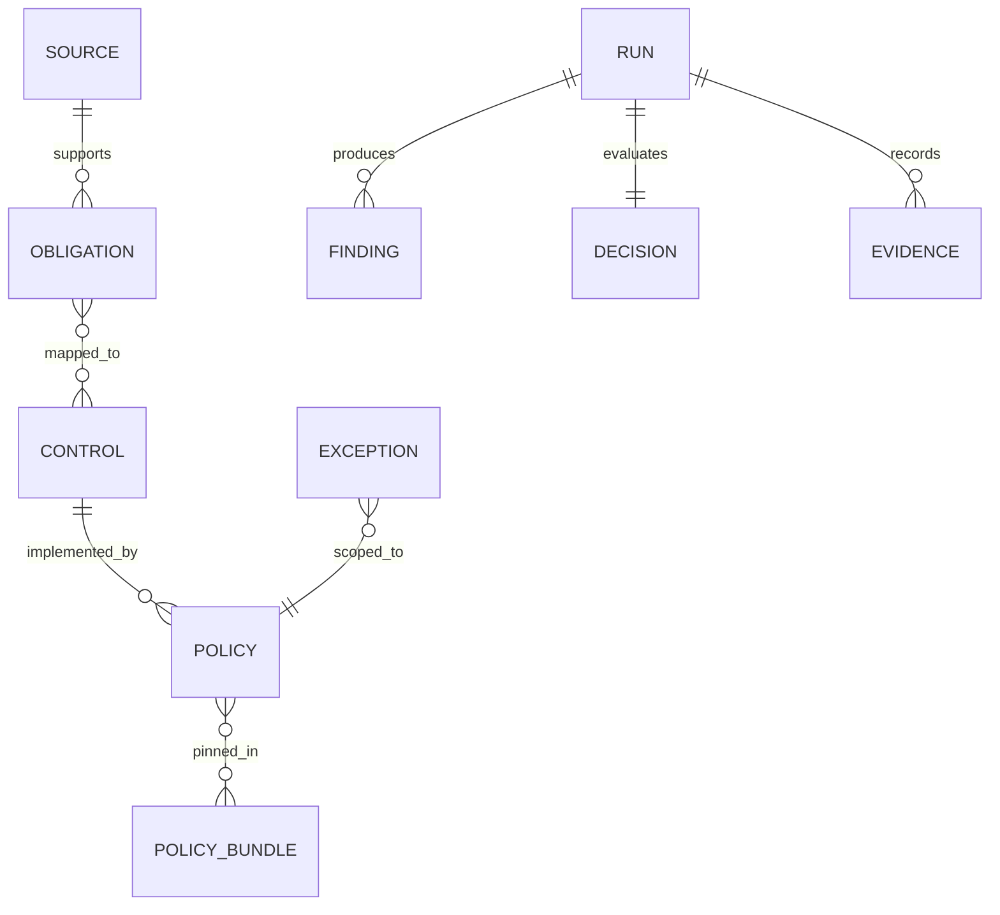

# 정책·통제 데이터 모델

> v0.2 로컬 구현 안내: 첫 Vertical Slice의 실제 실행은 [로컬 실행 안내](LOCAL_SLICE.md)를 따른다.
> 아래의 중앙 관리·기관 정책 승인·서명·운영 CI 요건은 장기 설계다. 이번 local_demo 실행은 이를 충족했다고 주장하지 않는다.

버전: 0.1 / JSON Schema: Draft-07 / 상태: 설계 계약

## 1. 관계

법령 원문의 의무(Obligation), 기관이 선택한 통제(Control), 실행 규칙(Policy)을 분리한다.
`supports`와 `mapped_to`는 구현 설계의 연결이며 법령이 특정 탐지기 사용을 명령한다는 뜻이 아니다.
모든 ID는 기관 내부에서 안정적으로 유지하고 버전이 달라진 객체는 덮어쓰지 않는다.

## 2. 주요 객체

| 객체 | 핵심 필드 | 제약 |
| --- | --- | --- |
| Source | id, title, url, edition, retrieved_at, verification, snapshot_digest | 원문 저장 전 digest는 null; 검색 결과를 원문 전체 확보로 표시 금지 |
| Obligation | id, source_id, clause, basis_kind, verification, applicability, effective_from, effective_until, temporal_note, summary | 조문 확인과 기관 적용 판단을 분리 |
| Control | id, version, obligation_ids, objective, owner_role, coverage | 한 통제로 법령 전체 준수를 주장하지 않음 |
| Policy | id, version, control_id, basis_kind, lifecycle, enabled, scope, condition, effect, evidence_requirements | 초안·예시 정책은 enabled=false |
| PolicyBundle | id, version, tenant_id, project_id, policy_refs, control_refs, obligation_refs, expires_at, digest, signature_status | 참조에 버전 고정; 승인·서명 검증 전 집행 금지 |
| Run | id, tenant_id, project_id, commit_sha, tree_digest, bundle_digest, tool_version, status, parent_run_id, started_at | 동일 입력에 재시도해도 Run ID는 별도 |
| Finding | id, run_id, detector_id, detector_version, category, severity, confidence, location, data_classes, coverage | 민원 값·원본 코드 snippet 필드 없음 |
| Decision | id, run_id, outcome, reason_codes, policy_refs, finding_ids, exception_ids | allow/deny는 정책 참조 필수; 사전 오류는 빈 참조 허용 |
| Exception | id, policy_id, finding_ids, tenant_id, project_id, requester, approver, expires_at, compensating_control, status | 독립 승인·범위·만료 검증 필수 |
| Evidence | id, run_id, parent_run_id, decision_id, provenance_kind, artifacts, manifest_digest, signature_status, receipt_status, retention_policy_id | fixture는 provenance_kind=example, 서명·receipt는 미완료 |

## 3. 법적 근거의 분류

- `statutory_obligation`: 법률·시행령·위임 고시의 의무. `verification=verified_clause`여도 기관 적용은 별도다.
- `institutional_policy`: 출처와 승인 이력이 있는 기관 규정. 현재 제공된 기관 규정은 없다.
- `example_policy`: 제품 설계의 예시 통제. 법적 의무로 승격하지 않는다.
- `unverified_requirement`: 원문·시행일·적용성 확인이 덜 된 항목. 준수로 판정하지 않는다.

`verification`: verified_clause / partial / pending.
`applicability`: applicable / not_applicable / conditional / pending.
`lifecycle`: draft / approved / retired.
`effective_from`과 `effective_until`은 조항의 적용 구간이다. 고시 전체 시행일을 모든 조항에 복사하지 않는다.
기준시점에 유효한 조항이 하나로 결정되지 않으면 `review_required`다.

## 4. 실행 정책 의미

첫 정책 `POL-EX-LOG-001@0.1.0`은 `finding.category == pii_logging_risk` 조건에서 deny를 제안한다.
데이터에는 임의 실행 코드·정규식 shell·LLM prompt를 판정식으로 저장하지 않는다.
필드 이름과 연산자를 허용 목록으로 제한한다. MVP 연산자는 `eq` 하나다.
범위는 기관·프로젝트·언어·단계로 제한한다. 예시의 기관 ID는 실제 기관을 뜻하지 않는다.

예시 정책을 시험하려면 구현된 엔진에서 별도 승인된 시험 묶음을 만들어야 한다.
JSON의 `enabled` 값만 바꿔 운영 정책을 승인한 것으로 취급하지 않는다.

## 5. 집행 시 검증하는 불변 조건

JSON Schema는 객체의 형태를 검사한다. 다음 의미 제약은 구현될 정책 엔진·검증기가 추가로 검사해야 한다.

1. 객체의 기관·프로젝트가 실행 주체와 일치한다.
2. 참조 ID와 버전이 존재하며 묶음 digest에 포함된다.
3. 활성 정책은 approved 상태이고 묶음 서명·만료 검사를 통과한다.
4. 법적 의무 기반 정책은 근거 조항과 시점·적용성 검토가 완료돼 있다.
5. 예외 요청자와 승인자가 다르고 현재 시각이 만료 전이다.
6. Decision의 Finding은 같은 Run에 속한다. 예외는 해당 정책·Finding만 면제한다.
7. 최종 allow는 필수 detector 완주, 현재 head 일치, 증적 receipt 검증을 모두 충족한다.
8. 예시 provenance를 가진 Evidence는 운영 판정의 증적으로 사용할 수 없다.

활성 정책이 없거나 해석할 수 없는 사전 오류는 policy_refs를 빈 배열로 두고 error로 기록한다.
allow/deny는 하나 이상의 유효한 정책 참조가 필요하다. error와 review_required는 게이트를 열지 못한다.

정적 스키마·예시는 형태와 관계를 설명한다. 로컬 실행기는 지원 범위의 입력·판정·연결·digest를 검증한다.
기관 권한·승인·서명·예외·시행 구간을 포함하는 운영 의미 제약 전체는 아직 구현하지 않았다.

## 6. 증적과 개인정보 최소화

Finding에는 경로·행 번호·분류만 저장한다. 경로에 개인정보가 있으면 로컬 별칭으로 바꾸고 별도 매핑을 보호한다.
소스 digest는 코드 아티팩트 식별용이다. 민원 원문이나 전화번호를 해시해 증적에 넣지 않는다.
`artifacts`는 상대 경로·SHA-256·미디어 유형을 기록한다. `..`와 절대 경로는 허용하지 않는다.
Manifest 자체는 artifacts 목록에 넣지 않는다. manifest_digest는 canonical manifest의 digest다.
서명과 저장소 receipt는 manifest 외부의 검증 메타데이터로 관리해 자기 참조를 피한다.

## 7. 호환성과 변경 관리

정책·통제·규정·스키마를 각각 버전 관리한다. enum 추가는 구형 Runner가 거부할 수 있으므로 호환성을 시험한다.
알 수 없는 필드·정책 연산자는 조용히 무시하지 않는다.
스키마가 통과해도 법적 타당성, 실제 탐지 성능, 암호학적 검증이 증명되지는 않는다.

## v0.2 로컬 실행 산출물

정적 examples의 provenance_kind=example은 유지한다. 실제 로컬 검사의 Evidence는 execution으로 구분한다.
Run·Finding·Decision·Evidence는 기존 계약에 맞춰 저장하고 실행 모드·소스 목록·분석 범위는 별도 메타데이터로 보관한다.
manifest와 로컬 receipt는 순환 참조가 없도록 분리한다.
정책 파일의 draft/disabled 상태는 변경하지 않는다. 실행의 local_demo 기록이 명시적 시험 활성화를 나타낸다.

## v0.3 외부 검사 출처

선택적 혼합 실행은 execution.json의 detectors에 python-local-flow와 iron-laws를 고정한다.
iron-laws.json은 외부 규칙 ID·상대 위치·심각도·판정과 도구 지문을 허용 목록으로 정제한 보조 보고서다.
Finding의 detector_id와 detector_version으로 출처를 구분하고, rule_id는 보조 보고서에 보존한다.
외부 일반 코드 위험 분류는 external_code_risk, 모호한 민감정보 분류는 potential_sensitive_data다.
iron-laws-policy.json은 CTRL-EXTERNAL-001과 연결한 별도 예시 정책이다.
혼합 bundle_digest는 두 예시 정책과 검사 모드, tool_digest는 하네스와 실제 외부 설치 환경 지문을 함께 포함한다.
보고서와 정책 아티팩트를 manifest·receipt·의미 재검증에 포함한다. 검증 때 외부 검사를 해제할 수 없다.

## v0.4.0 스냅샷 계약

snapshot.json은 독립 Draft-07 계약이다. format·commit_sha·scope·inventory_digest·files·total_bytes·supported_files·issues를 담는다.
files는 상대 경로·SHA-256·크기·분류·수집 이유를 기록한다. sources는 메모리 내부 입력으로 영구 아티팩트에 넣지 않는다.
분류 python_source는 AST 입력 가능 상태이며 분석 완료를 뜻하지 않는다. supporting_file은 내용 검사 통과가 아니다.
execution.json의 input_scope는 mode·commit_sha·worktree_checked를 고정하며 Run.tool_digest에도 연결한다.
부모 실행은 입력 모드와 detector 프로필이 일치해야 한다. 새 snapshot 아티팩트는 manifest·receipt·의미 재검증에 포함한다.
CLI 요약의 head_matches_commit은 반환 시 관측 정보이며 과거 기록의 영구 속성이나 CI 승인 근거가 아니다.

## v0.9 서명 참조 wire 계약

기존 catalog는 원래 Run·Finding·Decision·Evidence와 스캐폴드 예시의 형식이다.
Run에는 선택적 reference_context를 추가했고 context=synthetic_reference와 operational_approval=false만 허용한다.
기관·프로젝트 동일성은 실행기 의미 검증이 추가로 확인한다.

서명 참조는 별도 govcode-signed-v1 envelope(format·key_id·payload·signature)를 사용한다.
서명 바이트는 bounded canonical JSON이며 public trust의 subject·role·tenant·project를 따르고 payload의 자기 선언을 신뢰하지 않는다.
정책 원문은 불변이다. 원래 템플릿의 draft/disabled 표시는 보존하고 참조 워크플로의 signed draft·submit·independent approve와 묶음 발행을 별도 상태 근거로 사용한다.
이는 운영 승인 또는 비활성 예시를 승인 없이 활성화한 것과 다르며, 승인된 reference envelope가 없는 기본 예시는 계속 비활성이다.

예외 request는 policy_digest·commit_sha·tool_digest·finding_digests와 선택한 finding_ids를 고정한다.
run_id는 선택적 조회 메타데이터이며 권한의 근거가 아니다. 의미 digest는 실행/탐지 ID를 제외한 원본 commit·현재 도구·범위·정책·탐지의 의미 필드에서 재계산한다.
철회는 예외 양쪽 서명자와 양쪽 서명 기록에 적용한다.

archive는 검증한 같은 바이트의 manifest에 묶은 파생 투영이며 원본 unsigned 실행을 운영 서명으로 승격하지 않는다.
부모는 ID·manifest digest·commit·범위가 있는 최대16개의 순서 있는 투영 사슬이다.
역사적 무결성 결과의 kind는 archive_integrity이고 release_approval=false다. 현재 CI 판정과 서로 다른 결과 유형이다.

model proposal의 new_content는 private 수정 검토 자료다. 영구 receipt는 코드 원문 대신 proposal/approval digest·모델/프롬프트·전후 commit·범위·검사 상태만 담는다.
fixture 모델과 실제 모델 실행 여부를 구분한다.
