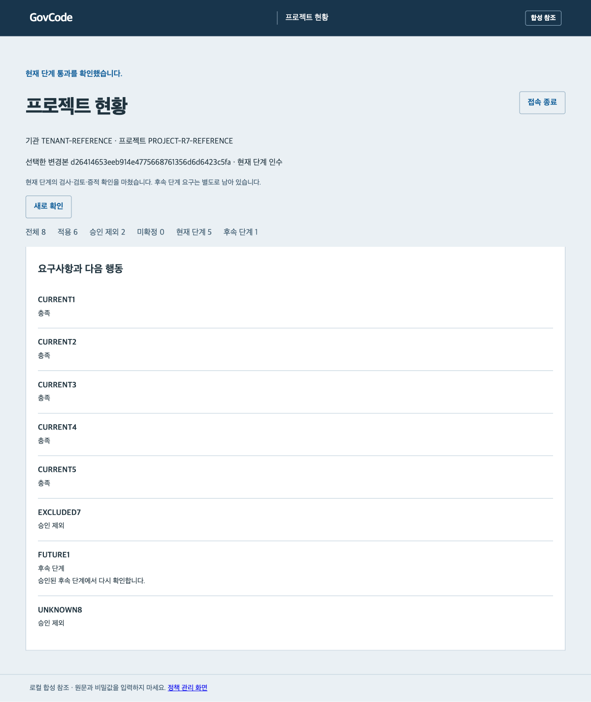

# 전체 프로젝트 참조 실행 안내

## 목적과 범위

이 실행은 사업 산출물·요구사항 추적과 기존 개인정보 로깅 검사를 연결한다.
프로필·팩·적용성·문서·시험·독립 검토·현재 단계 게이트·증적 보관과 복구를 로컬 합성 자료로 확인한다.
실제 기관·실데이터·실모델·원격 CI·운영 승인이나 법적 준수 인증을 수행하지 않는다.
v0.11.0 사전 릴리스에 포함한다. 이전 v0.10.0에는 이 전체 흐름이 포함되지 않는다.

## 전체 실행

프로젝트 루트에서 참조 환경을 준비하고 새 출력 경로를 사용한다.

```sh
python3 scripts/setup_reference.py
.runtime/reference-venv/bin/python -m govcode_harness project-demo --output .runtime/my-project-demo
```

서명 참조 환경은 Python 3.12 이상과 고정 의존성을 사용한다. 기존 기본 로깅 데모의 명령과 의미는 유지한다.
실행은 새 비공개 폴더 안에 합성 저장소·개발 키·프로필·규정 팩·시험 및 검토 증명을 생성한다.
출력 폴더가 이미 있으면 중단한다. 기존 업무 저장소나 다른 프로젝트를 수정하지 않는다.
제안·승인을 실제 서명 알고리즘으로 검증하지만 행위자와 자료는 합성이다. 생성된 개발 키를 기관 운영 키로 사용하지 않는다.

표 1. 전체 요구 8개의 전후 상태

| 구분 | 처음 | 수정·재검사·독립 검토 후 |
| --- | --- | --- |
| 적용 확인 | 6개 | 6개 |
| 승인 제외 | 1개 | 2개 |
| 적용 미확정 | 1개 | 0개 |
| 현재 단계 대상 | 5개 | 5개 |
| 현재 단계 충족 | 2개 | 5개 |
| 추적 누락 | 1개 | 0개 |
| 현재 산출물 검토 대기 | 1개 | 0개 |
| 실행 증명 미연결 | 1개 | 0개 |
| 후속 단계 | 1개 | 1개 |

처음의 검토 필요 총수에는 적용 미확정 1개도 포함된다. 화면과 보고서는 적용 조건과 수행 상태를 별도로 유지한다.
최종 allow는 현재 인수 단계의 입력·검사·검토·보관 확인 결과다. 전체 8개를 100% 준수나 프로젝트 완료로 표시하지 않는다.

## 실행이 실제로 확인하는 것

1. 프로필과 규정 팩을 독립 승인하고 발행·잠금·철회 정보의 신뢰 기준을 검증한다.
2. commit의 같은 바이트에서 문서 구조와 요구→설계→시험→검토 연결을 검사한다.
3. 기존 개인정보 로깅의 실제 스캔과 서명 정책 기반 코드 게이트를 실행한다.
4. 누락 추적의 제안을 author가 서명하고 다른 approver가 승인한다.
5. 원본을 보존한 새 작업 복사본에 승인한 인덱스 변경만 적용한다. 새 commit의 실제 부모는 원본 commit이다.
6. 미확정 사실을 명시적으로 확인한 합성 프로필 새 버전과 잠금본을 만들고 적용 제외를 독립 검토한다.
7. 새 commit의 필수 검사·실행 증명·산출물 검토를 다시 연결한다. 마지막 검토는 실제 프로젝트 서비스의 인증 행위자로 서명한다.
8. 새 평가를 원문 없는 서명 증적으로 보관하고 현재 단계 게이트가 같은 증적을 확인한다.
9. 역할·nonce·보존 기한·hold를 검사하고, 서명 백업을 새 경로에 실제 복구한다.
10. 검증한 백업 후 이 데모가 만든 원래 보관 폴더만 제거해 저장소 상실을 모사한다. 복구한 보관기의 실제 증적으로 다시 현재 게이트를 확인한다.

별도의 위험 코드 저장소에서는 실제 로깅 위험을 검출하고 코드와 결합 게이트가 차단되는지 확인한다.
과거 commit·프로필·잠금·검토·실행 증명·증적과 변조 자료는 현재 통과로 재사용하지 않는다.
문서의 passed·승인 문구나 호출자가 제공한 통과 표시를 신뢰하지 않는다.

## 프로젝트 화면

실행한 출력 폴더의 설정으로 loopback 서버를 시작한다.

```sh
.runtime/reference-venv/bin/python -m govcode_harness control --config .runtime/my-project-demo/control-config.json --port 8766
```

브라우저에서 http://127.0.0.1:8766/project.html 을 연다. 접속 토큰은 출력 폴더의 tokens/author.token, tokens/approver.token, tokens/operator.token, tokens/auditor.token에 각각 있다.
이 토큰과 설정·개발 키·제안 파일은 비공개다. 공개 이슈나 저장소에 올리지 않는다.
작성자는 현황·작업을 보고 독립 승인할 수 없다. 검토자는 현재 자료를 별도로 확인하고 검토 근거를 기록한다.
기관·프로젝트·역할·서명키·대상 commit·경로는 관리자 설정에서 선택한다. 요청 본문으로 덮어쓸 수 없다.
접속 토큰은 브라우저 메모리에만 유지하고 접속 종료 때 비운다. 서버 종료는 실행 터미널에서 Ctrl+C로 수행한다.

그림 1. 복구한 증적을 확인한 프로젝트 현황의 합성 화면



[모바일 폭의 합성 화면](images/project-desk-mobile.png)에서도 전체 요구와 후속 단계를 유지한다.
검토 기록이 만료되면 서명한 이력을 보존하면서 새 검토를 요청한다. 변조·미래 시각·현재 입력 불일치는 통과시키지 않는다.
관리자가 고정한 외부 검토 파일과 신뢰 기준의 변경·만료는 관리자에게 재설정을 요청해야 한다.

## 파일과 검사 결과

프로그램 응답의 files는 출력 폴더 기준 상대 파일 이름이다. project-reference-result.json은 실제 확인한 checks와 전후 개수를 기록한다.
assessment-before.json과 assessment-after.json은 요구별 평가이고, stage-after.json은 현재 단계 판정이다.
control-config.json은 복구한 보관기를 참조한다. 원래 보관기가 제거돼도 과거 투영 읽기와 현재 원본 재검증을 구분한다.
private의 제안·승인 파일에는 변경 검토용 본문이 포함될 수 있다. 일반 증적에는 문서 원문·키·토큰을 복사하지 않는다.
백업은 보관기의 운영 메타데이터를 포함하는 비공개 자료이며 공개 투영과 구분해 보호한다.

원본 입력을 검증하는 개별 명령은 [작업·충족 평가](PROJECT_ASSESSMENT_RUNBOOK.md), [단계·보관 안내](PROJECT_STAGE_EVIDENCE_RUNBOOK.md), [산출물 검사](ARTIFACT_TRACE_RUNBOOK.md)를 따른다.

## 한계와 실제 적용 전 조건

입력은 제한된 JSON·Markdown과 기존 Python 로깅 분석 범위다. 큰 저장소·HWPX·PDF·Office·새 언어 어댑터는 별도 작업이다.
문서 작성 정책과 구조 검사 외에 사실·수치·의미는 사람이 원문과 대조해야 한다.
서명·hash chain은 운영 WORM·KMS·기관 신원 연동을 대신하지 않는다. 전체 로컬 롤백 탐지에는 외부에서 보호한 최신 checkpoint가 필요하다.
철회 목록·최소 순번·신뢰 목록·코드 정책 문맥·증적 설정을 검사 checkout 밖에서 관리한다. 전달되지 않은 오프라인 철회를 즉시 알 수는 없다.
현재 코드 검사와 충족 평가의 결합은 임의 모델의 실제 생성 품질이나 모든 공공 업무의 안전성을 입증하지 않는다.
[실제 운영 준비 조건](EXTERNAL_READINESS.md)은 남아 있으며, 비개발자의 실제 도구 제작 과정에 대한 사용성 검증도 필요하다.
