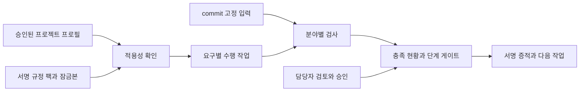
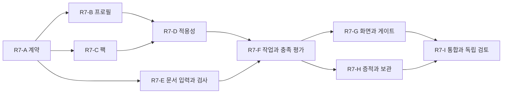

# R7 프로젝트 프로필·분야별 규정 팩 구현 계획

기준일: 2026-10-29 KST / 상태: R7-A~D 릴리스·이후 개발 R7-E·R7-F~I 로컬 구현·검증 / 목표: v0.10 로컬 참조 확장
기준 구현: v0.9.0-apache2. 사용자가 선택한 첫 확장 분야: **사업 산출물·요구사항 추적**.
현재 법령 적용을 새로 확정하거나 기관 운영 배포를 승인하는 문서가 아니다.
R7-A/B의 사용은 [프로필 실행 안내](../PROJECT_PROFILE_RUNBOOK.md), R7-C/D는 [팩·적용성 실행 안내](../RULE_PACK_APPLICABILITY_RUNBOOK.md)를 따른다.

## 1. Summary — 요약

프로젝트 조건에 맞는 규정 팩을 선택하고, 요구를 수행 작업·산출물·검사·담당자 검토·증적으로 연결한다.
첫 확장은 요구사항이 설계·시험 계획·시험 결과·검토 기록에 연결되는지 확인하는 흐름이다.
현재 개인정보 로깅 검사와 함께 실행해, 서로 다른 분야를 공통 프로필과 증적으로 묶는 것을 검증한다.

## 2. What you will get — 완료 후 사용할 기능

- 버전과 승인 이력이 있는 프로젝트 프로필, 적용 규정 팩 목록과 고정 잠금본.
- 요구별 적용 이유·확인할 정보·담당자·산출물·다음 작업 안내.
- 요구 ID 누락·중복·끊긴 추적·오래된 시험 자료를 찾는 산출물 검사.
- 수정 초안 확인 → 새 commit에 적용 → 재검사 → 독립 검토 → 증적 생성.
- 충족·미충족·미검증·검토 대기·기한 전·승인된 적용 제외를 구분하는 화면과 단계별 게이트.

상세 데이터 계약·실행 경계·시험 목록은 [상세 명세](../PROJECT_PROFILE_RULE_PACK_SPEC.md)를 따른다.

## 3. What will be built — 구현 단위

| 단위 | 사용자에게 제공할 결과 | 규모 | 구현·검토 책임 |
| --- | --- | --- | --- |
| R7-A 공통 계약 | 프로필·팩·잠금본·추적·평가 기록의 형태와 의미 검증 | M | 구현 담당자, 계약 검토자 |
| R7-B 프로젝트 프로필 | 조건 입력·미확정 사실 표시·개정·독립 승인 | M | 구현 담당자, 적용성 검토자 |
| R7-C 규정 팩 | 출처·요구·작업·검사·증적의 묶음과 서명·철회·잠금 | L | 구현 담당자, 정책 검토자 |
| R7-D 적용성 | 확인한 사실로 적용 후보를 계산하고 미확정은 검토 작업으로 연결 | M | 구현 담당자, 독립 논리 검토자 |
| R7-E 산출물·추적 검사 | 불변 문서 입력과 요구→설계→시험→검토의 연결 검사 | L | 구현 담당자, 독립 표본 작성자 |
| R7-F 작업·충족 평가 | 수정 안내·문서 초안·재검사·승인과 전체 요구 현황 | M | 구현 담당자, 상태·권한 검토자 |
| R7-G 화면·단계 게이트 | 프로젝트 중심 조회와 승인된 단계별 통과 조건 | L | 구현 담당자, UI·게이트 검토자 |
| R7-H 증적·보관 | 새 평가 기록의 원문 없는 투영·검증·서명 보관·복구 | M | 구현 담당자, 증적 검토자 |
| R7-I 통합 인수 | 두 분야의 전체 실행, 회귀·음성 시험·실행 안내 | M | 구현 담당자와 별도 검토자 |

M은 여러 계약을 연결하는 단위, L은 신뢰 경계나 입력 처리가 큰 단위다. 별도 담당자 배정은 아직 하지 않았다.

## 4. How it fits together — 전체 연결

규정 팩은 실행 프로그램이 아니다. 승인된 검사 어댑터와 작업 양식을 참조한다.
단계 게이트의 성공을 기존 코드 게이트 또는 프로젝트 전체 준수 인증으로 바꾸지 않는다.

## 5. How it gets built — 구현 순서

최초 착수는 **R7-A + R7-B**였으며 현재 R7-E까지 로컬 개발했다. 이후 R7-F~I 로컬 구현과 검증은 [완료 보고](../R7_COMPLETION_REPORT.md)를 따른다. 계약과 프로필 승인·버전·미확정 사실을 먼저 고정한다.
팩과 문서 검사 준비는 계약 고정 후 독립적으로 진행할 수 있다. 이 도식은 실행 의존관계이며 병렬 에이전트 실행 지시가 아니다.
각 단위는 집중 시험을 통과해야 다음 통합에 포함한다. 최종 인수에는 기존 릴리스 회귀 전체의 재실행이 포함된다.

## 6. Decisions you can change — 기본 설계와 미확정 조건

| 항목 | 이번 계획의 기본값 | 다시 결정할 조건 |
| --- | --- | --- |
| 첫 확장 사례 | 사용자 선택: 사업 산출물·요구사항 추적 | 후속 분야 착수 전 별도 선택 |
| 입력 | Git에 고정한 UTF-8 JSON·Markdown, 단일 저장소 | 실제 기관 양식·여러 저장소가 필요할 때 |
| 저장 | 버전 파일과 서명 이력, 로컬 참조 | 동시 편집·기관 신원 연동 시 |
| 판정 | 결정적 검사, 별도 담당자 검토·승인 | 지원하는 검사 어댑터를 추가할 때 |
| 수정 지원 | 구조화 문서·추적 초안, 확인 후 새 commit | 새 문서 형식·AI 사용을 허용할 때 |
| 커밋·공개 | 이 계획은 문서만 작성; 구현·릴리스는 별도 착수 요청 후 | 사용자 구현·게시 요청 시 |

실제 기관·계약 문서·규정 적용본·승인자·보존 분류는 미제공이다. 합성 팩을 운영 정책으로 발행하지 않는다.

## 7. Risks — 주요 위험과 대응

- 문서가 존재한다는 이유로 요구가 충족됐다고 오판: 구조 검사·추적 검사·실행 결과·내용 검토를 분리한다.
- 미확정 정보가 적용 제외로 바뀜: 미확정은 검토 필요, 제외는 근거와 독립 승인이 있어야 한다.
- 팩 안의 실행 명령·문서 주입: 허용한 어댑터 ID만 사용하고 문서의 지시를 실행하지 않는다.
- 규정·프로필·문서를 바꾼 뒤 과거 승인을 재사용: 입력과 승인 대상 digest가 바뀌면 현재 평가는 다시 해야 한다.
- 전체 미검증을 숨긴 충족률: 고정된 전체 요구 수와 모든 상태를 함께 표시한다.

## 8. Out of scope — 이번 확장의 제외 범위

전 법령 자동 해석·법적 준수 인증, 실제 기관 승인·검수 대행, 실데이터 파일럿·원격 CI 배포, HWP/HWPX/PDF/Office 자동 추출, 임의 플러그인 실행, 여러 저장소 통합, 실모델 자동 문서 작성·반출은 포함하지 않는다.
접근성 등 다른 분야는 공통 팩 계약에 수용할 수 있도록 설계하되 이번 검사 구현 범위로 표시하지 않는다.

## 9. How we will know it works — 사용자 인수 시나리오

1. 승인한 프로필에 산출물 팩과 기존 로깅 연결 팩을 고정한다.
2. 합성 요구 8개를 전부 표시하고, 누락된 시험 연결·미확정 적용 조건·승인 대기를 숨기지 않는다.
3. 다음 작업 안내로 문서와 추적을 수정한다. 파일 생성만으로 자동 통과시키지 않는다.
4. 새 commit에서 필요한 검사를 재실행하고 해당 산출물에 대한 독립 검토를 받는다.
5. 현재 단계의 통과 결과와 증적을 만든다. 향후 단계 요구가 남아 있음을 계속 표시한다.
6. 프로필·팩·문서·시험 자료 또는 승인자를 바꾼 음성 시험에서는 과거 통과가 재사용되지 않는다.

상세 명세의 인수 항목 A01~A18과 기존 회귀가 모두 통과하고 독립 검토 지적이 해소돼야 v0.10 참조 확장을 완료로 표시한다.

## 10. Rough time and cost — 개략 규모

개발·시험·독립 검토를 포함해 **25~40인일**을 초기 추정 범위로 둔다. 계약과 실제 입력을 고정한 뒤 재산정한다.
기관 자료 확보·적용성 검토·승인 대기는 별도다. 인건비 단가·모델·인프라가 정해지지 않았으므로 금액 견적은 산정하지 않는다.
이 수치는 착수일·출시일·자동 실행 소요 시간의 약속이 아니다.

## R7-E 개발 연결

[구조 정리·R7-E 실행 계획](2026-10-30-structure-and-artifact-trace.md)과 [실행 안내](../ARTIFACT_TRACE_RUNBOOK.md)를 따른다. 기존 릴리스 기준선은 439개이며 이번 새 시험도 후속 회귀에 유지한다.

## 전체 로컬 참조 결과

[완료 보고](../R7_COMPLETION_REPORT.md)와 [전체 실행 안내](../PROJECT_REFERENCE_RUNBOOK.md)를 따른다. 초기 계획용 버전 표기는 실제 공개 릴리스 상태가 아니다. 기관 운영·실모델·추가 분야는 별도 조건이다.
